# Claims Platform

Motor and property Claims across six APAC Markets. Claimants report and track Claims; Officers assess, approve, reject and settle them. One Angular app, one ASP.NET Core API, Kafka for domain events.

For a visual tour (architecture, every decision, and the build journal as a timeline), open [docs/overview.html](docs/overview.html) in a browser.

Domain terms mean what [GLOSSARY.md](GLOSSARY.md) says.

## Screens

<table>
  <tr>
    <td>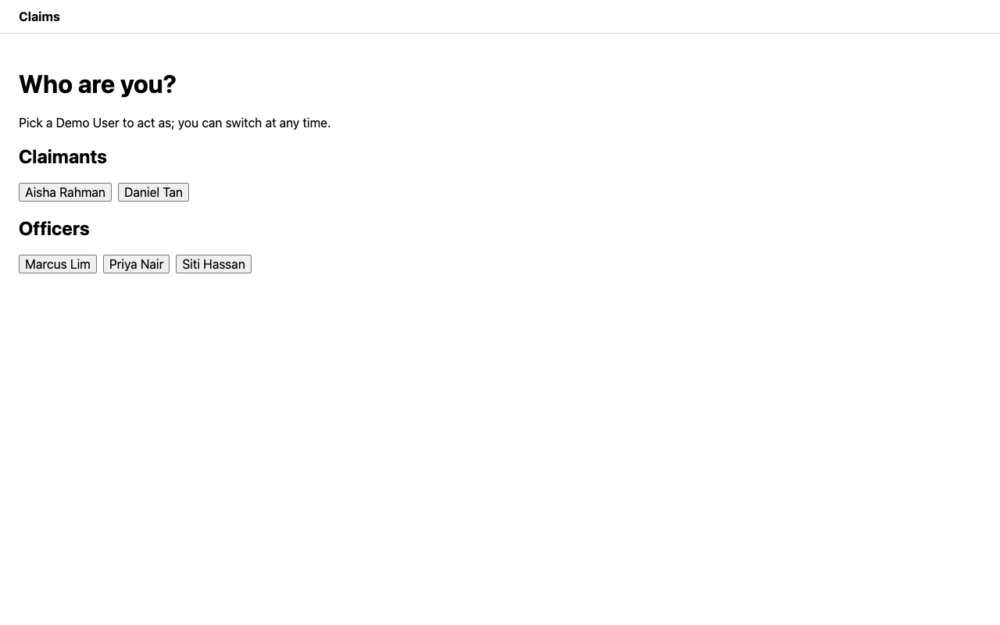<br>Role picker: choose a demo Claimant or Officer</td>
    <td>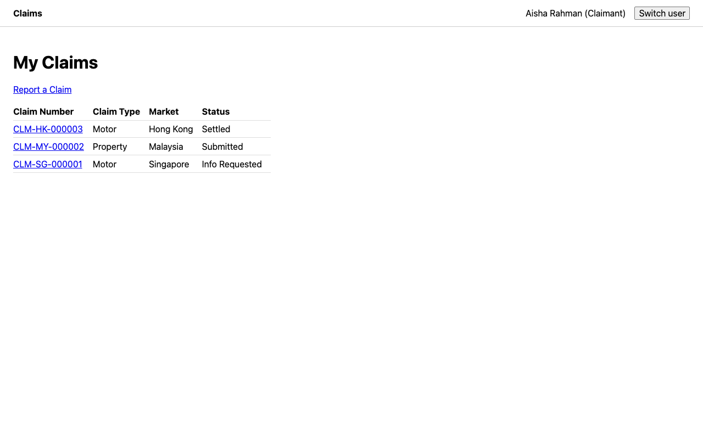<br>My Claims: a Claimant's Claims, newest first</td>
  </tr>
  <tr>
    <td>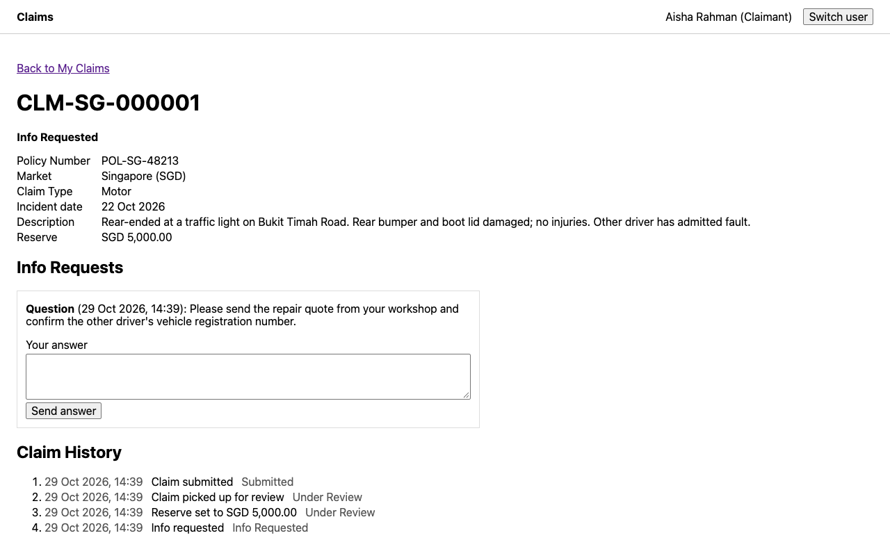<br>Claimant's Claim: status timeline and Info Requests</td>
    <td>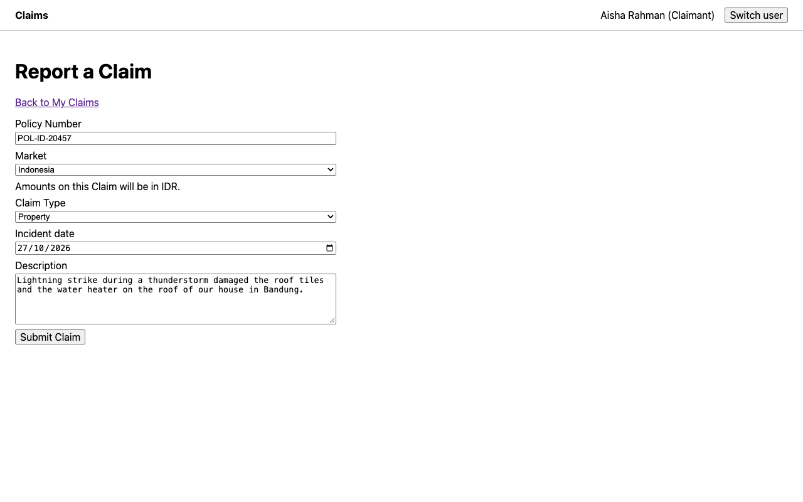<br>Report a Claim</td>
  </tr>
  <tr>
    <td>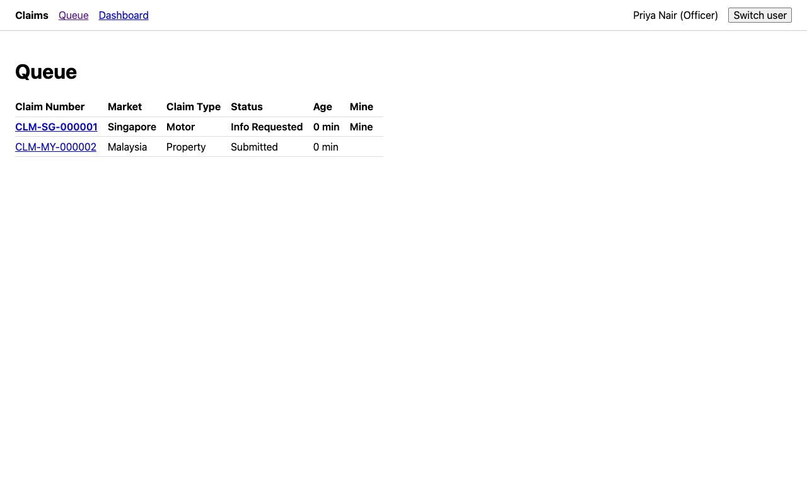<br>Officer Queue: unassigned and own Claims, oldest first</td>
    <td>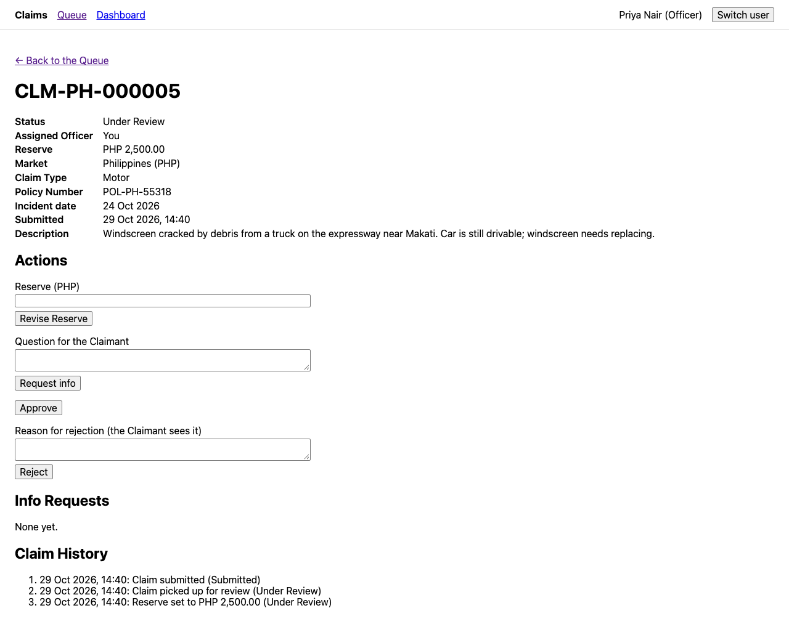<br>Officer's Claim: Reserve, Info Request and decisions</td>
  </tr>
  <tr>
    <td>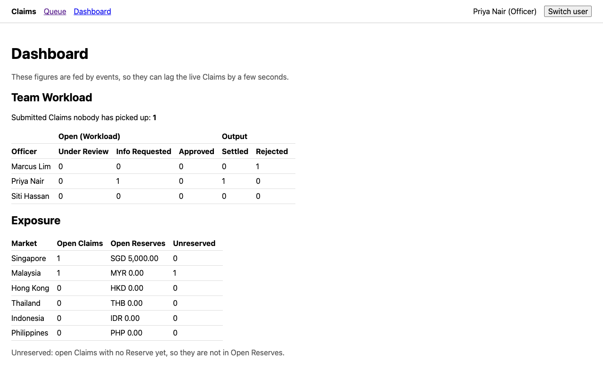<br>Dashboard: Team Workload per Officer; Exposure (outstanding Claims) per Market</td>
    <td></td>
  </tr>
</table>

## Prerequisites

| Tool | Version |
|------|---------|
| .NET SDK | 10 (brief: 8 or later; 10 is the current LTS) |
| Node.js, with npm | 22.22.3+, 24.15+ or 26+ (what Angular 22 supports) |
| Docker | With Docker Compose |

## Run it

From the repo root; one terminal per long-running command.

```sh
docker compose up -d --wait          # Postgres on 5433, Kafka on 9092
dotnet run --project src/Claims.Api  # the API
```

To add a migration you need the local dotnet-ef tool: `dotnet tool restore`. Running the app doesn't; startup applies migrations.

```sh
cd web
npm install
npm start                            # the Angular app
```

| What | Where |
|------|-------|
| The app | http://localhost:4200 |
| The API | http://localhost:5169 |
| Swagger UI | http://localhost:5169/swagger |

In Development, startup applies migrations, seeds five demo users and creates the topics `claim-events` and `claim-events-dlq`. Kafka is on by default (`Kafka:Enabled` in `src/Claims.Api/appsettings.json`). If Kafka is down, REST still works and Kafka is retried.

**Swagger:** call `GET /api/users`, then **Authorize** with a user's `id` as `X-User-Id` and `role` as `X-Role`. Every other endpoint needs both.

## Run the tests

```sh
dotnet test
```

Needs the Compose Postgres (database `claims_test`). Kafka is switched off, so it needn't be up. No Angular tests (out of scope).

## Demo script

| Claimants | Officers |
|-----------|----------|
| Aisha Rahman, Daniel Tan | Priya Nair, Marcus Lim, Siti Hassan |

Use **Switch user** in the header. Watch the API terminal: simulated emails print there.

1. **Claimant submits.** As Aisha, **Report a Claim**: any Policy Number, Singapore, Motor, today, a description. She gets a Claim Number such as `CLM-SG-000001`, Submitted. The console prints `Simulated email to Claimant <id>: "We've received your Claim CLM-SG-000001" - ...`.
2. **Officer picks it up.** As Priya, open it from the Queue and pick it up: Under Review. Set a Reserve of 5000. Request info. (Claimants see the Reserve too, by design: D65.)
3. **Claimant answers.** As Aisha, see Info Requested and the question. Answer: back to Under Review. The timeline shows every step.
4. **Officer approves.** As Priya, approve. **Dashboard**: Singapore counts it as open, SGD 5,000.00 in Open Reserves.
5. **Officer settles.** With the Dashboard open in a second window, settle. The Claim is Settled at once. Singapore's open count and Open Reserves drop typically within a second, plus up to 5 seconds until the next refresh: eventual consistency.

Picking up, requesting info, approving and settling each email Aisha.

**Conflict rule:** open one Submitted Claim as Priya, and as Marcus in a private window (the demo user is shared through localStorage). Click **Pick up** in both within 5 seconds, before the refresh hides the button. The second gets a clear 409. Or send the pick-up twice in Swagger, once per Officer.

## Architecture

### The pieces

ADR: [0001](docs/adr/0001-modular-monolith.md), [0004](docs/adr/0004-transactional-outbox.md), [0005](docs/adr/0005-one-topic-keyed-by-claim.md). Decisions: D25, D90.

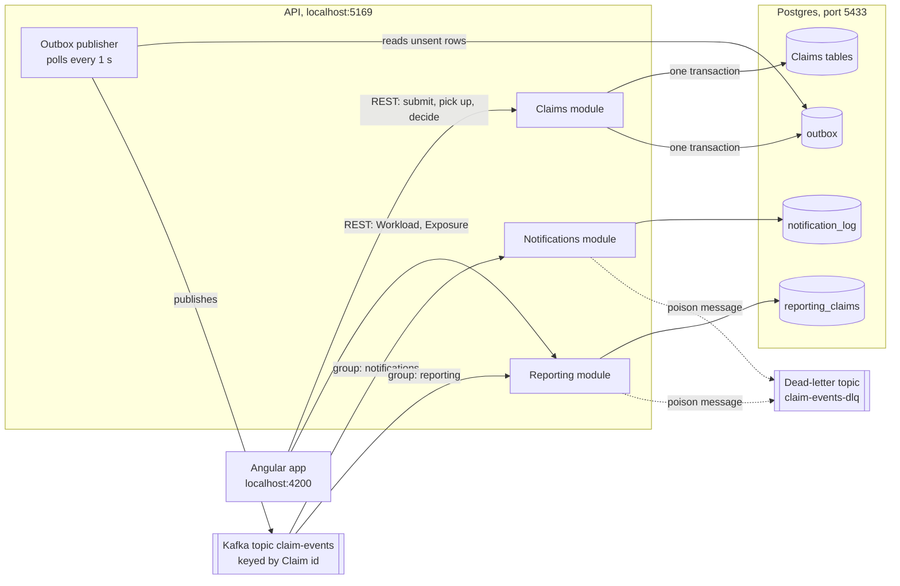

A modular monolith: one API, three modules, each a folder in `src/Claims.Api`.

| Module | Owns |
|--------|------|
| **Claims** | The Claim, Info Requests, Claim History, and their REST endpoints |
| **Notifications** | Simulated emails, to a log table and the console |
| **Reporting** | Its own read model; serves Workload and Exposure |

Notifications and Reporting read only events, never the Claims tables: the seam a later split follows.

### REST vs Kafka

ADR: [0003](docs/adr/0003-rest-for-requests-kafka-for-events.md), [0005](docs/adr/0005-one-topic-keyed-by-claim.md).

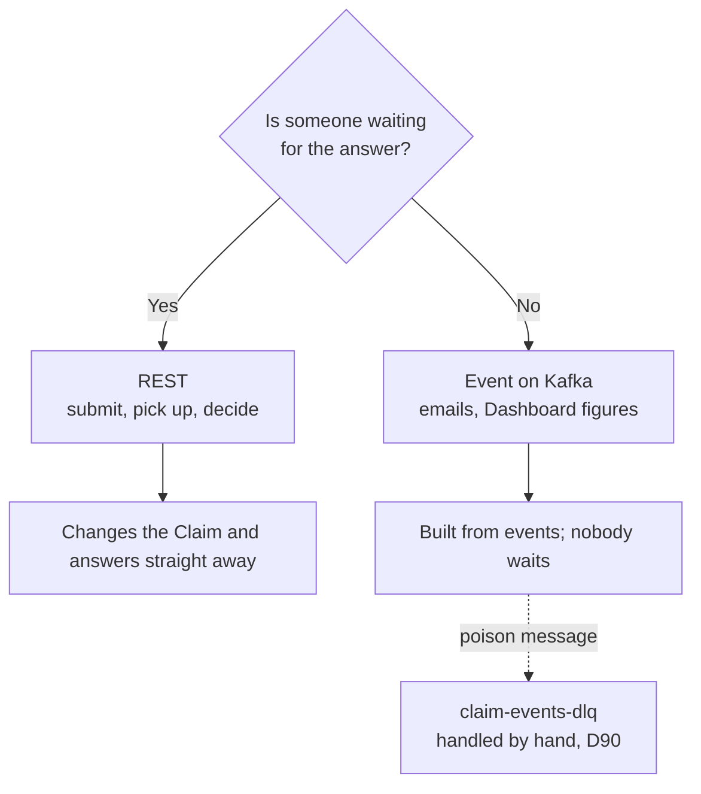

One topic, `claim-events`, keyed by Claim id, so each Claim's events stay in order.

### Claim status flow

Decisions: D11, D12, and the spec's status table.

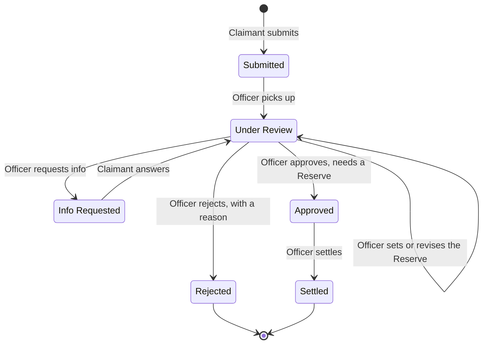

Setting the Reserve, requesting info, approving, rejecting and settling are for the Assigned Officer only (D11). Pick-up checks only that the Claim is Submitted. Settled and Rejected are final.

### Which response a request gets

Decisions: D12, D13, D23, D60, D66. Order checked against `Claim.cs` and `ClaimsController.cs`.

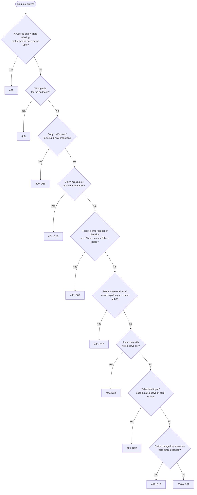

The first rule a request breaks decides the answer. Pick-up has no Assigned Officer check, so a second Officer gets 409.

### One change, end to end

ADR: [0004](docs/adr/0004-transactional-outbox.md), [0005](docs/adr/0005-one-topic-keyed-by-claim.md). Decision: D16.

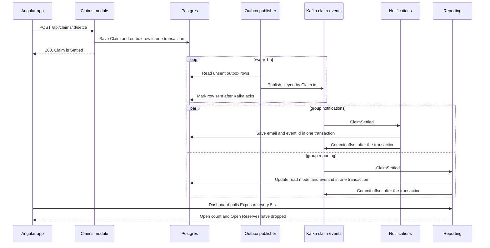

REST never talks to Kafka: a Kafka outage can't fail a Claimant's action, and a crash can delay an event but not lose it.

### What a consumer does with a message

Decisions: D16, D90 (supersedes D68's skip for unknown types, D74 and D79). ADR: [0005](docs/adr/0005-one-topic-keyed-by-claim.md).

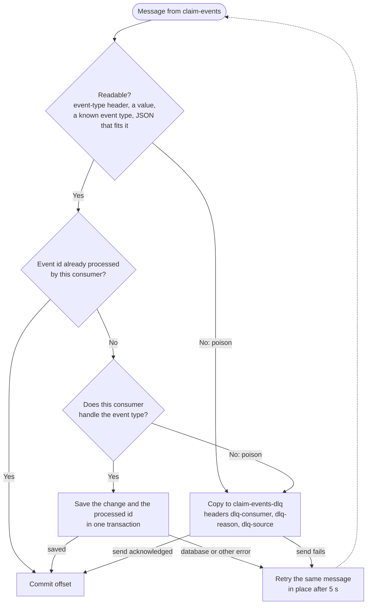

Poison (missing or null required fields, a null event-type header, an unknown type, values the database can't store such as an unknown Market or a currency that isn't 3 letters) is never recorded as processed, so nothing stalls and a replayed copy counts as new.

### Eventual consistency and identity

| Topic | Rule |
|-------|------|
| **Eventual consistency** | The Queue and Claim screens read live data. The Dashboard reads Reporting's read model, a second or two behind. My Claims, Claim detail (both roles), the Queue and the Dashboard poll every 5 s, and show an error if a request takes over 4.5 s. While Kafka and the consumers are healthy, a change typically reaches the Dashboard within about 6 s |
| **Identity** ([ADR-0006](docs/adr/0006-trusted-identity-headers.md)) | No login. The role picker sends `X-User-Id` and `X-Role`; the API trusts them, and still enforces and tests every authorisation rule |

Every choice and its alternatives: the [decision log](docs/decisions.md) and the [ADRs](docs/adr/).

## Assumptions

**Six Markets, one currency each.** Currency comes from the Market and is never entered or added across currencies (D7).

| Market | Code | Currency |
|--------|------|----------|
| Singapore | SG | SGD |
| Malaysia | MY | MYR |
| Hong Kong | HK | HKD |
| Thailand | TH | THB |
| Indonesia | ID | IDR |
| Philippines | PH | PHP |

Policy Numbers are typed in and not verified (D8).

## Known limits

| Limit | Detail | Production fix |
|-------|--------|----------------|
| UI amounts (D73) | JavaScript numbers: exact to about 15 significant digits. API, database and Claim History are exact | |
| Topic creation | `claim-events` and `claim-events-dlq` are created in Development only; elsewhere they must exist | |
| Dead letters (D90) | A message a consumer can't read, or whose event type it doesn't know, is copied to `claim-events-dlq` and the consumer moves on. Headers say which consumer sent it, why, and where it came from; each consumer sends its own copy. Until it is replayed by hand, Reporting's totals miss that event. To replay, fix the cause (deploy the handler or correct the payload), then produce the message back onto `claim-events` with its key and `event-type` header; a consumer that already handled it skips it by event id. A late replay can move Reporting's row back to an older status or Reserve: check the Claim's current state first, or rebuild the row from its events in order | Automated replay (What's next) |
| Stale screen (D80) | `xmin` catches simultaneous saves, not a stale screen: an old tab approves at the current Reserve | ETag and If-Match |
| Stale answer (D91) | The answer doesn't name its Info Request, so an answer written in an old tab for an earlier question can be saved against a newer question, and the Claim goes back to Under Review | Send the Info Request id and answer 409 if it isn't the open one, or ETag and If-Match |
| Extreme amounts (D82) | Around 1e28, the Exposure sum can overflow and fail | |
| Broker restart (D88) | Outbox republished in about 2.5 s; consumers took about 45 s more. Nothing lost. Suspected, unconfirmed cause: the group rejoining under the default 45 s session timeout, so it stays unchanged | Diagnose, then tune |
| Outbox growth (D83) | The table only grows | Partial index on unsent rows, archive job |
| Claimant sees the Reserve (D65) | By design: one Claim shape for both roles | |

Inspect the dead letters (Ctrl+C to stop):

```sh
docker compose exec kafka /opt/kafka/bin/kafka-console-consumer.sh --bootstrap-server localhost:9092 --topic claim-events-dlq --from-beginning --formatter-property print.headers=true --formatter-property print.key=true
```

## Troubleshooting

| Symptom | Fix |
|---------|-----|
| Dashboard shows Claims that don't exist: events from another API on the same Kafka, or from before a database reset | `docker compose down -v`, then **Run it** again. Wipes all Postgres and Kafka data |
| API can't reach Postgres | `docker compose ps` should show Postgres healthy on 5433 |
| First run logs one EF Core `fail: ... An error occurred using the connection to database 'claims'` | Harmless, logged before the database is created |
| npm warns `install-scripts ... not yet covered by allowScripts` | Harmless; the app builds and runs without them |

## What was left out

| Area | Left out |
|------|----------|
| Identity | Real authentication (OIDC/JWT), Manager role, reassigning Claims |
| Policy | Verification, coverage checks, policyholder lookup |
| Documents | Attachments, file uploads |
| Lifecycle | Claimant withdrawal, reopening, timeouts on unanswered Info Requests |
| Money | Partial or negotiated settlements, payments, currency conversion |
| Notifications | Real email delivery, notifications in the UI |
| Reporting | Time-based measures, such as average time to settle |
| Updates | Server push (SSE or SignalR); the UI polls |
| Delivery | Containers, deployment, CI |
| Tests | Angular tests; automated tests of the Kafka consume, commit and rewind loop, `OutboxPublisher` and `KafkaTopicCreator`, all checked by hand (D87). `DeadLetterTests` does drive the consumers' `HandleAsync`, with a fake producer |
| Structure | A project per module; any service split |

## What's next

1. **Split out Reporting first.** It has its own tables and only hears events, so it moves to its own service and database. First the event contracts (`ClaimEvent`, `ClaimStatus`, `Market`; D76) and the shared consumer base move into a shared contracts project; Claims' behaviour is untouched.
2. Real login (OIDC/JWT): Program.cs swaps the authentication scheme; `CurrentUser` keeps reading the signed-in user (it may need a claim mapping); controllers and authorisation rules stay; the Angular role picker and identity interceptor become a login flow.
3. A Manager role, with reassignment of Claims.
4. Server push (SSE) instead of polling.
5. Automated dead-letter replay (D90).
6. Stop stale screens acting: ETag and If-Match, so an old tab can't approve at a changed Reserve (D80); and the Info Request id on an answer, with 409 if it isn't the open one, so an answer can't be saved against a newer question (D91).
7. Policy lookup against the policy administration system.
8. Containers, CI and deployment.

## How it was built

The Matt Pocock skills workflow, with Jay's extensions. Entry numbers point to [AI_JOURNAL.md](AI_JOURNAL.md).

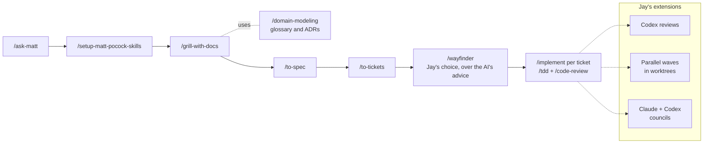

Each skill's output fed the next; the extensions changed how tickets were reviewed, run and decided.

| Skill | What it produced | Why it helped | Entry |
|-------|------------------|---------------|-------|
| `/ask-matt` | The workflow: grill, spec, tickets, implement per ticket | Shows how Jay directs agents; set vertical slices, backend first | #2, #3 |
| `/setup-matt-pocock-skills` | `docs/agents/`, triage labels, one `GLOSSARY.md` and `docs/adr/` | Every later skill reads the same tracker and docs layout | #3 |
| `/grill-with-docs` | 31 decisions, `GLOSSARY.md`, ADRs 0001–0006, `docs/decisions.md` | One decision at a time, each with what it was chosen over; caught the missing `ReserveSet` event (D32) | #4, #5 |
| `/domain-modeling` | `GLOSSARY.md` and ADRs, kept up to date as decisions settled | `/grill-with-docs` already uses it, so it kept running throughout | #5 |
| `/to-spec` | The spec: 64 user stories, REST contract, events, three test seams | Fixed the test seams; flagged five gaps for Jay to confirm | #6 |
| `/to-tickets` | 12 tickets with blocking links | Backend slices first, then Angular, then README | #7 |
| `/wayfinder` | Map #1, spec #2, tickets #3–#14 as GitHub sub-issues | **Jay's choice over the AI's advice:** one source of truth for the whole assignment | #8 |
| `/implement` (`/tdd` + `/code-review`) | Each ticket test-first at the spec's seams, reviewed, committed | Reviews found real bugs, logged per ticket | #12–#16 |
| Codex reviews | A Codex review beside every Claude review | A second model; it found bugs the Claude reviews missed, such as a redirect loop | #15, #20 |
| Parallel waves | Three waves of builder agents, each in its own worktree and databases | Jay: to show he can direct several agents safely; waves follow the blocking links | #17, #18 |
| Councils | Two Claude agents and Codex decide; two of three wins, dissent recorded | Jay: "more inputs from different models are better" | #19, #43 |
| Lead orchestrates | Builder and fixer agents write code; the lead reviews, merges and journals | Keeps the lead on dispatch and records | #21 |

`/implement-spec` and `/retro` were planned (#2) but replaced by the parallel waves and the councils. `/codebase-design` was only a reference pulled in by `/tdd` (#5).

For the full picture, open [docs/overview.html](docs/overview.html) in a browser.

## Repo layout

| Path | What |
|------|------|
| `AI_JOURNAL.md` | How AI was directed, challenged and overridden |
| `GLOSSARY.md` | Domain terms |
| `docs/agent-prompt.md` | The AI pair-programmer's opening prompt |
| `docs/decisions.md`, `docs/adr/` | Decision log and ADRs |
| `docs/overview.html` | Visual tour |
| `docker-compose.yml` | Postgres and Kafka for local runs |
| `src/Claims.Api` | The API: `Claims/`, `Notifications/`, `Reporting/`, shared `Infrastructure/` |
| `tests/Claims.Api.Tests` | Unit and integration tests |
| `web/` | The Angular app |
